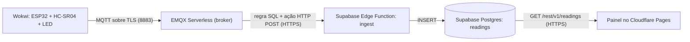

# Caixa d'água IoT — monitoramento de nível com ESP32, MQTT e Supabase

Sistema de monitoramento IoT **simulado** (sem hardware físico). Um sensor ultrassônico **HC-SR04** fica no topo de uma caixa d'água e mede a distância até a superfície da água. O **ESP32** converte a distância em **nível (%)** e, quando o nível fica **abaixo de 20 %**, o sistema entra em **alerta** (LED no ESP32 e aviso no painel web).

Projeto da disciplina de Arquitetura de Computadores — Atividade IoT (Opção A, com MQTT). Todos os dados são sintéticos.

## Links

| Item | Link |
|---|---|
| Painel publicado (Cloudflare Pages) | https://silent-hat-6d46.marialuh219.workers.dev/ |
| Projeto Wokwi | https://wokwi.com/projects/481408424441715713 |
| Vídeo de demonstração (YouTube, não listado) |  |


## Arquitetura



| Bloco | Função |
|---|---|
| **ESP32 + HC-SR04 (Wokwi)** | Mede, trata e publica o nível a cada 10 s |
| **EMQX (broker MQTT)** | Recebe as mensagens no tópico do grupo e repassa à API por uma regra |
| **Edge Function `ingest` (API REST)** | Autentica, valida o contrato JSON e grava no banco; descarta duplicatas |
| **Postgres (Supabase)** | Guarda o histórico mesmo com o painel fechado |
| **Painel (Cloudflare Pages)** | Consulta a API e mostra valor atual, unidade, horário, histórico, alerta e dados desatualizados |

## Como o ESP32 trata o sinal (`wokwi/main.py`)

1. **3 medições** seguidas do HC-SR04 (pulso de 10 µs no TRIG; duração do ECHO ÷ 58 = distância em cm).
2. **Validação:** só valem distâncias entre **2 e 400 cm**; é preciso ao menos 2 de 3 válidas, senão há "FALHA SENSOR" e nada é enviado.
3. **Média** das medições válidas.
4. **Conversão cm → %:** `nível = (100 − d) / (100 − 5) × 100`, limitado a 0–100 (`TANK_EMPTY_CM = 100`, `TANK_FULL_CM = 5`).
5. **Comparação:** `alert = nível < 20`. O LED (GPIO19) acende em alerta.

Leitura a cada **2 s** e envio MQTT a cada **10 s**. O alerta começa com a água a ≈ 81,5 cm do sensor.

Ligações no Wokwi: VCC → 5V, GND → GND, TRIG → GPIO5, ECHO → GPIO18, LED (com resistor de 330 Ω) → GPIO19.

## Contrato JSON (ESP32 → MQTT → API)

```json
{
  "device_id": "g01",
  "message_id": "g01-<boot>-<contador>",
  "metric": "water_level",
  "unit": "%",
  "level_percent": 54.9,
  "distance_cm": 47.8,
  "alert": false
}
```

A função `ingest` responde **201** (gravou), **200** (duplicata, `inserted: false`), **400** (contrato inválido) ou **401** (chave errada).

## Banco de dados

Tabela `public.readings` (ver `supabase/schema.sql`):

| Coluna | Tipo | Observação |
|---|---|---|
| `device_id` | text | identifica o dispositivo (chave primária composta) |
| `message_id` | text | evita duplicatas (chave primária composta) |
| `metric`, `unit` | text | grandeza (`water_level`) e unidade (`%`) |
| `level_percent` | double | 0 a 100 |
| `distance_cm` | double | 2 a 400 |
| `alert` | boolean | decidido no ESP32 |
| `received_at` | timestamptz | horário de gravação no servidor |

RLS habilitado: o painel só **lê** (chave publishable); só a função `ingest` **grava**.

## Estrutura do repositório

| Pasta | Conteúdo |
|---|---|
| `wokwi/` | Firmware MicroPython, circuito (`diagram.json`) e configuração (com placeholders) |
| `emqx/` | Regra SQL, corpo da ação HTTP e configuração (sem segredos) |
| `supabase/` | `schema.sql`, `conferir.sql`, `config.toml` e a função `functions/ingest/index.ts` |
| `site/` | Painel (`index.html` + `config.js` com valores públicos) |
| `certificados/` | CA pública `supabase-gts-root-r4.pem` (usada pelo EMQX para falar com o Supabase) |
| `testes/` | JSONs de teste e roteiro de testes da API |
| `registros/` | Mapa do ambiente e evidências dos testes |
| `docs/` | Guia de publicação no GitHub |

## Segredos: o que NÃO está neste repositório

| Segredo | Onde fica |
|---|---|
| Senha do banco | Só no Supabase |
| `INGEST_KEY` | Supabase (Edge Functions > Secrets) e header da ação no EMQX |
| Senha MQTT | EMQX e `config.py` **dentro do projeto Wokwi** (aqui há placeholder) |
| `sb_secret` / `service_role` | Só no Supabase (a função lê do ambiente) |

O `site/config.js` contém apenas a URL do projeto e a chave **publishable**, que é pública por design.

## Como reproduzir

1. **Supabase:** crie um projeto; execute `supabase/schema.sql` no SQL Editor; crie o secret `INGEST_KEY`; crie a função `ingest` com o código de `supabase/functions/ingest/index.ts` e **desligue Verify JWT**. Teste com `testes/corpo_api.json` (ver `testes/LEIA-ME.txt`).
2. **EMQX Serverless:** crie um deployment; crie o usuário MQTT; em Authorization, libere Publish no tópico do grupo e negue o resto (`#`); crie um conector HTTP para a URL do Supabase (TLS ativo, CA `certificados/supabase-gts-root-r4.pem`, SNI = domínio do Supabase); crie a regra com `emqx/regra.sql` e a ação `POST /functions/v1/ingest` com body `${.}` e o header `x-ingest-key`.
3. **Wokwi:** crie um projeto ESP32 MicroPython; copie os arquivos de `wokwi/`; preencha `MQTT_HOST` e `MQTT_PASSWORD` em `config.py` (sem espaços) e cole a CA do EMQX em `ca_cert.py`; execute a simulação.
4. **Cloudflare Pages:** edite `site/config.js` com a URL e a chave publishable do Supabase e publique a pasta `site/` (Direct Upload).

O tópico MQTT precisa ser **idêntico** no `FROM` da regra do EMQX, na permissão do usuário e no `TOPIC` do `config.py`.

## Testes realizados

Resultados registrados em `registros/evidencias.csv` e mostrados no vídeo:

| Teste | Resultado esperado |
|---|---|
| Fluxo completo | Mudar a distância no Wokwi → linha em `readings` → valor no painel |
| Alerta | Distância > 81,5 cm → `alert = true`, LED aceso, painel em vermelho |
| Interrupção e retomada | Tecla `x` + Enter no Serial pausa a rede; o painel mostra "Dados desatualizados" após 30 s e volta ao normal ao retomar |
| Painel fechado | Leituras continuam sendo gravadas e aparecem ao reabrir o painel |
| Duplicata | Mesmo `message_id` retorna 200 e não cria nova linha |

## Influência do intervalo de coleta

Leituras a cada 2 s tornam a medição mais responsiva, mas só uma a cada 10 s é enviada: um intervalo de envio menor aumenta o tráfego MQTT, as chamadas à função e o volume de linhas; um maior atrasa o alerta e deixa o painel mais tempo com dados antigos. O limite de 30 s para "dados desatualizados" equivale a 3 envios perdidos.

## Limitações

- Não há fila offline: leituras durante a pausa de rede são perdidas (simplificação didática).
- O estado "desatualizado" usa o relógio do navegador; diferença de relógio pode afetá-lo.
- A credencial MQTT fica visível para quem abrir o projeto Wokwi; por isso o usuário só pode publicar no próprio tópico.
- A leitura da tabela é pública (dados sintéticos).
- O sensor é simulado: o modelo do Wokwi não reproduz ruído, ecos nem a necessidade de divisor de tensão no ECHO (5 V → 3,3 V) de um circuito real.
